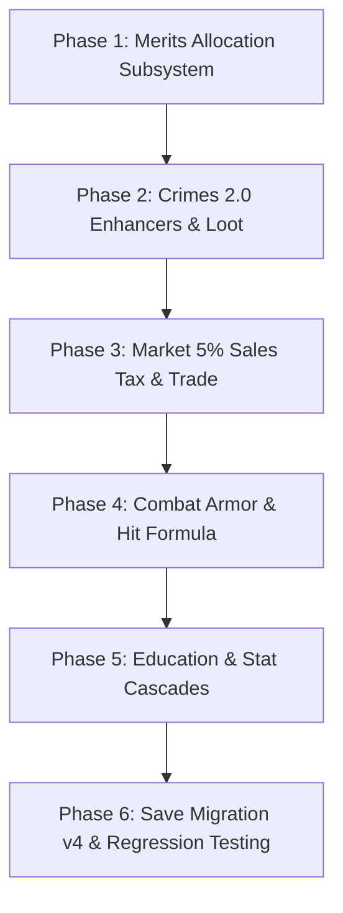

# CALIGO — IMPLEMENTATION & INTEGRATION ROADMAP
**Execution Strategy:** Incremental, Non-Breaking, Test-Verified  
**Target:** Caligo Phase 4 (Deep Systems Integration)  
**Verification:** Automated node simulation test suite (`simulate.js`)

---

## IMPLEMENTATION PHASES & STEP-BY-STEP WORKFLOW

### Phase 1: Merits Allocation Engine & Dedicated Screen
1. **State Extension (`js/state.js`):**
   - Initialize `sv.player.meritUpgrades = { sharpness: 0, brawn: 0, protection: 0, evasion: 0, crit: 0, nerve_bar: 0, ce: 0, edu: 0, bank: 0, mug: 0, life: 0 }`.
   - Update `S.calcMaxNerve` to add `+1 * meritUpgrades.nerve_bar`.
   - Update `S.calcMaxLife` to add `+3% * meritUpgrades.life`.
   - Update `S.playerPower` and effective stats with merit multipliers.
2. **Action Handlers (`js/actions.js`):**
   - `A.upgradeMerit(meritId)`: Spends merit points (cost = currentLevel + 1 or flat 1 per tier up to 10), updates state, triggers audio FX, adds toast.
   - `A.resetMerits()`: Allows re-specing merits with confirmation.
3. **Dedicated Screen (`js/ui/screens/merits.js`):**
   - Full 11-category UI card grid displaying current tier, bonus, upgrade button, and available unallocated merits.
4. **Sidebar & Router Integration (`js/ui/sidebar.js`, `router.js`, `index.html`):**
   - Route `#/merits` added to router.
   - Sidebar `[use]` button navigates directly to `#/merits`.

### Phase 2: Crimes 2.0 Enhancers & Unique Outcomes
1. **Data Additions (`js/data/items.js`):**
   - Add crime enhancer tools: `flashlight` (Flashlight), `cut_razor` (Cut-Throat Razor), `high_drive` (High-Speed Drive), `duct_tape` (Duct Tape), `lighter` (Windproof Lighter), `mountain_bike` (Mountain Bike), `jemmy` (Jemmy / Crowbar).
2. **Crime Table Depth (`js/data/crimes.js`):**
   - Attach `enhancerItemId` and `uniqueDrop` metadata to crime definitions.
   - Burglary and Pickpocketing sub-targets with required lockpicks/cutters.
3. **Execution Engine (`js/actions.js`):**
   - Detect matching enhancer in inventory in `A.commitCrime`.
   - Award +10% success bonus and display custom enhancer notification.
   - Roll critical success (<8%) for unique outcome items + bonus cash.

### Phase 3: Market 5% Sales Tax & Economic Realism
1. **Economy Actions (`js/actions/economy.js`):**
   - Update `A.buyMarketListing` to deduct 5% municipal sales tax on sales.
   - When player or bot listing sells, seller receives 95% net payout.
   - Display transparent tax breakdown in `market.js`.
2. **Bank APR Merits Integration:**
   - Factor `meritUpgrades.bank` (+5% APR per level) into fixed deposit yields in `A.openDeposit`.

### Phase 4: Combat Engine Realism & Official Formulas
1. **Armor Mitigation (`js/actions/combat.js`):**
   - Implement official formula: $D_{\text{mitigated}} = D_{\text{raw}} \times (1 - \text{ArmorTotal} / 100)$.
2. **Dexterity/Speed Ratio Hit Formula:**
   - Accurate dynamic hit chance curve based on attacker Speed vs defender Dexterity.
3. **Critical Strike Calculation:**
   - Add `meritUpgrades.crit` (+1% crit per level) and Biology Anatomy education bonus (+5% crit).

### Phase 5: Education & Syndicate Passives Cascade
1. **Passives Integration (`js/state.js` & `actions/education.js`):**
   - Calculate completed education course bonuses:
     - Health & Fitness courses (+% Str/Spd/Dex/Def).
     - Mathematics & Computer Science (+% hacking & ammo efficiency).
     - Psychology Bachelor (+10% crime success).
     - Sports Science (+1% gym gains).
2. **Faction Syndicate Perks:**
   - Active syndicate perks factor into combat power, street trade profits, and travel times.

### Phase 6: Migration Protocol & Automated Test Verification
1. **Save Migration (`js/storage.js`):**
   - Migrate v3 saves to v4 safely, ensuring `meritUpgrades` and new inventory items are seeded seamlessly.
2. **Test Suite Expansion (`simulate.js`):**
   - Add Test Suite 20: Merits Upgrades & Allocation verification.
   - Add Test Suite 21: Crime Enhancers & Unique Loot verification.
   - Add Test Suite 22: Market 5% Sales Tax verification.
   - Verify all 36 screens render cleanly.
