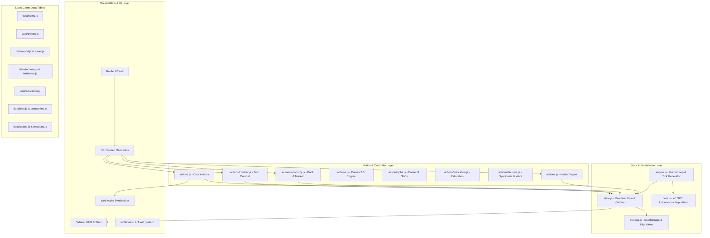
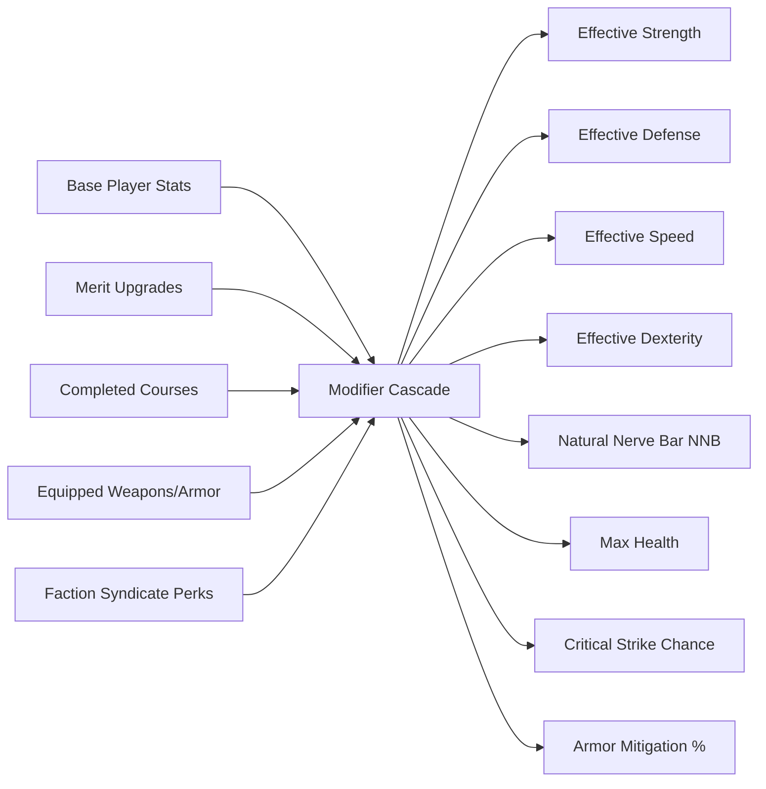
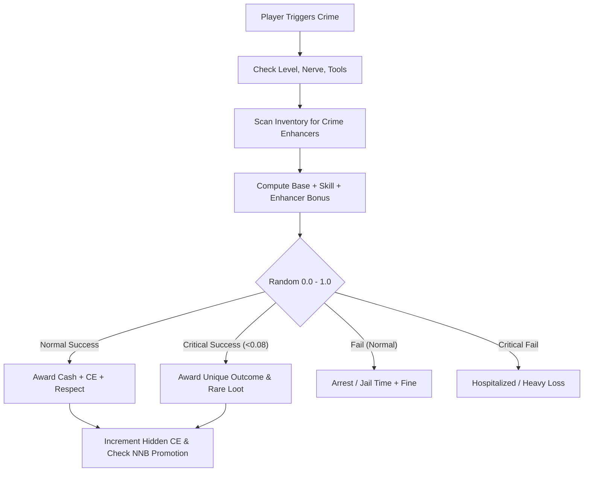

# CALIGO — SYSTEM ARCHITECTURE SPECIFICATION
**Version:** 4.0 (Deep Integration Edition)  
**Date:** 2026-10-27  
**Scope:** Client-Side Single-Page Vertical City RPG  
**Target Architecture:** Vanilla ES5/ES6 JavaScript (No Build Step, No Node.js Dependencies in Browser)

---

## 1. HIGH-LEVEL ARCHITECTURAL TOPOLOGY

Caligo is structured as a modular, event-driven client-side application executing completely within the browser sandbox with zero external server dependencies:

---

## 2. MODIFIER CASCADE & DERIVED STATS FLOW

Caligo's stat progression implements an un-bounded modifier stack derived from Base Stats, Equipment, Merits, Education, and Faction Perks:

### Mathematical Specifications:

1. **Natural Nerve Bar (NNB):**
   $$\text{Max Nerve} = \text{Base Nerve} (15) + \lfloor\text{Level} / 2\rfloor + \text{HiddenTier}(\text{CE}) + \text{Merit}(\text{nerve\_bar})$$

2. **Official Armor Damage Mitigation:**
   $$D_{\text{mitigated}} = D_{\text{incoming}} \times \left(1 - \frac{\text{Armor Rating}}{100}\right)$$
   Where total armor rating is the sum of equipped Head, Body, and Leg defenses.

3. **Hit Probability (Speed vs Dexterity):**
   $$P(\text{hit}) = \text{clamp}\left(0.50 + \frac{\text{Speed}_{\text{attacker}} - \text{Dexterity}_{\text{defender}}}{\text{Speed}_{\text{attacker}} + \text{Dexterity}_{\text{defender}} + 100} + \text{Modifier}_{\text{move}}, 0.10, 0.95\right)$$

4. **Market Sales Tax:**
   $$\text{Seller Net Payout} = \text{Listing Price} \times 0.95$$
   A 5% sales tax is collected by the City Treasury, preserving economic balance.

---

## 3. CRIMES 2.0 SUBSYSTEM DESIGN

Crimes 2.0 integrates three layers of depth over standard RNG rolls:

### Enhancer Item Mapping:
- **Burglary:** Flashlight (+10% success, avoids detection)
- **Pickpocketing:** Cut-Throat Razor (+10% success)
- **Hacking / Cybercrime:** High-Speed Drive / Laptop (+12% success)
- **Card Skimming:** Duct Tape (+8% success)
- **Shoplifting:** Mountain Bike (+10% quick getaway)
- **Arson:** Windproof Lighter (+10% success)

---

## 4. PERSISTENCE & SAVE MIGRATION ARCHITECTURE

The local storage payload is managed by `js/storage.js` with version-gated migration transforms:

- **v1:** Initial prototype state (Phase 1).
- **v2:** Added 40 NPC bots, stock market, travel platforms (Phase 2).
- **v3:** Added Torn-style sidebar, jobs, education, companies, factions, casino, missions (Phase 3).
- **v4 (Current):** Added Merits Allocation System (`meritUpgrades`), Crimes 2.0 Enhancers & Unique Loot tables, Market 5% Sales Tax, and official combat formulas.

Each migration is idempotent and non-destructive: existing attributes are preserved while new structures are initialized with defaults.
